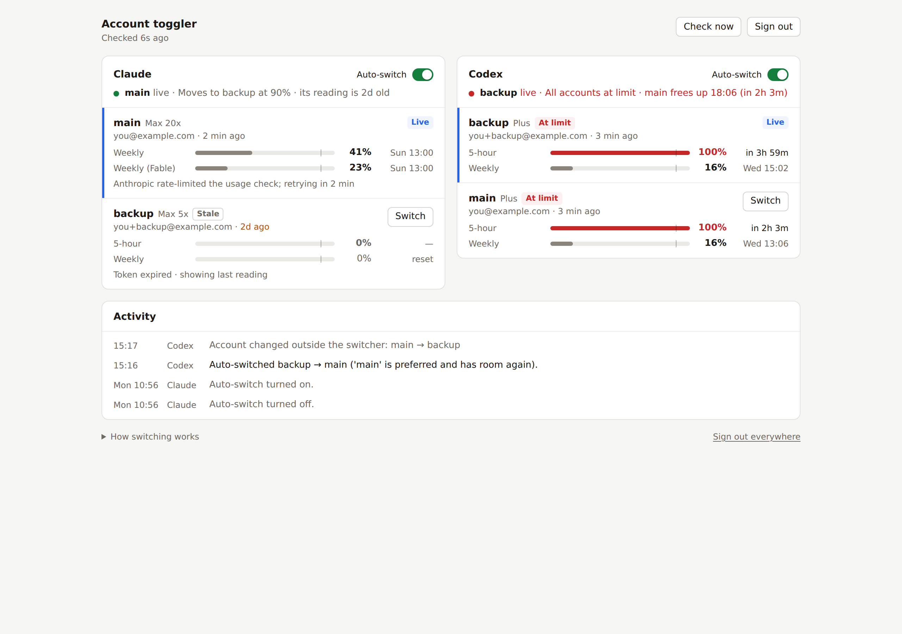

# claude-account-ui

A small, password-protected web page for switching which Claude subscription
Claude Code (and anything that runs it, such as T3 Code) uses on a machine. It can
also switch automatically when an account gets close to its usage limit.

It sits on top of a `claude-account` CLI (`list`, `use <name>`) that keeps one
saved login per account. The page lists the accounts, highlights the active one,
shows 5-hour and weekly usage, and switches with one click.



- Python standard library only. Files: `server.py`, `index.html`, `login.html`.
- Listens on `127.0.0.1` and is meant to sit behind a TLS reverse proxy.
- Every page and API call needs the master password from `.env`.

## Setup

```sh
cp .env.example .env && chmod 600 .env    # then set MASTER_PASSWORD and SESSION_SECRET
scripts/install-hooks.sh                  # leak-check hooks (see below)
python3 server.py                         # or install the systemd user service:

cp claude-account-ui.service ~/.config/systemd/user/
systemctl --user daemon-reload && systemctl --user enable --now claude-account-ui
journalctl --user -u claude-account-ui -f
```

The server refuses to start if `MASTER_PASSWORD` is shorter than 20 characters,
`SESSION_SECRET` is shorter than 32, `.env` is readable by other users, `BIND` isn't
loopback, or `PUBLIC_PORT` and `ALLOWED_HOSTS` aren't set together. For the service to
start at boot without a login, enable lingering: `loginctl enable-linger $USER`.

Over SSH, without a domain: `ssh -N -L 8765:127.0.0.1:8765 <your-vm>`, then open
http://localhost:8765.

## Putting it on a domain

The server has two listeners, both on 127.0.0.1, each with its own connection pool:

| Listener | For | Accepts `Host` | Proxy headers | Treated as |
|---|---|---|---|---|
| `PORT` (8765) | this machine and the SSH tunnel | `localhost`, `127.0.0.1` | ignored | local |
| `PUBLIC_PORT` | your reverse proxy **only** | `ALLOWED_HOSTS` | client IP from the last `X-Forwarded-For` hop | internet: HTTPS required, global lockout, Secure cookies only |

Put a TLS reverse proxy on the same machine, point it at `PUBLIC_PORT`, then add this
to `.env` and restart the service:

```sh
PUBLIC_PORT=8767
ALLOWED_HOSTS=claude.example.com   # requests for any other Host get 421
```

- **Cloudflare Tunnel + Cloudflare Access (strongly recommended):** no open ports on
  the VM. Point a public hostname at `http://127.0.0.1:8767`, add an Access policy
  that allows only your email, and turn on *Always Use HTTPS*. Bots then never reach
  the password page at all.
- **Caddy:** `claude.example.com { reverse_proxy 127.0.0.1:8767 }` gives automatic
  HTTPS. Caddy sets the forwarded headers itself. Also set
  `request_buffers 4KiB` and short `read_header`/`read_body` timeouts.

Never point the proxy at `PORT`. It wouldn't work anyway (wrong `Host` → 421). Because
the two pools are separate, a flood against the public side can't lock you out of the
SSH tunnel. On the public listener, plain-HTTP page loads are redirected to HTTPS, and
plain-HTTP logins and cookies are refused. Pick a hostname that isn't easy to guess:
certificates are published in Certificate Transparency logs, so scanners find new
hostnames within minutes.

## Security model

| Threat | Defence |
|---|---|
| Password guessing | 20+ character random password. Each IP (IPv6 per /64) gets 5 wrong tries per 15 min, and all local connections share one counter. 20 wrong tries per hour from the whole internet lock new internet logins for the hour. Browsers that signed in before (a signed device cookie) and the SSH tunnel are exempt, so an attacker can't lock you out. Each failure adds 1 s, and at most 4 password checks run at once. Failures are logged with the client IP (`journalctl --user -u claude-account-ui \| grep FAILED`). |
| Stolen or forged cookie | HMAC-SHA256 signed, server-side session list (sign-out really revokes; *Sign out everywhere* revokes all), expires after `SESSION_DAYS` (14), HttpOnly, SameSite=Strict. Remembered-browser (device) cookies are also kept server-side, and *Sign out everywhere* forgets them. From the internet only the `__Host-`/Secure cookie over HTTPS is accepted. Changing the password or `SESSION_SECRET` also invalidates every cookie. |
| Eavesdropping | Logins and cookies over plain HTTP from the internet are refused. HSTS is sent over HTTPS. |
| CSRF / other sites | SameSite=Strict cookies, same-origin JSON-only POSTs (CORS preflight never granted), Origin check. |
| XSS / clickjacking | Nonce-based CSP with no `unsafe-inline`, all data rendered with `textContent`, `frame-ancestors 'none'`, `X-Frame-Options: DENY`. |
| DNS rebinding, host scanning | Unknown `Host` headers get 421. `robots.txt` and `X-Robots-Tag` keep it out of search engines. |
| Slow-loris / floods | A request must arrive completely within 8 s. Each listener allows at most 64 connections (extra ones are dropped), and the local listener has its own pool. The unit sets `TasksMax`/`MemoryMax`, switch/check calls are throttled, and junk connections log one line, not a traceback. Put it behind Cloudflare for real DoS protection. |
| Fingerprinting | No `Server` header, `/healthz` only answers locally, `robots.txt` disallows everything, and every response sends `X-Robots-Tag: noindex`. |
| Token exposure | The server never prints or stores tokens. It reads access tokens only to query Anthropic's usage endpoint, and redacts anything token-shaped from CLI output. Secrets are removed from the environment before child processes start. |

## Auto-switch

Every `POLL_SECONDS` (60) the server asks Anthropic's usage endpoint how full each
account's 5-hour and weekly limits are. When the active account reaches
`THRESHOLD` % (90) of any limit, it runs `claude-account use <next>`. Accounts are
preferred in `PRIORITY` order, so it moves back to the first one once that one's
limit resets. If every account is over the threshold, it stays where it is.

- Anthropic allows only a few usage checks per window, and Claude Code spends some
  of them too. So the server also uses Claude Code's own latest reading (from
  `~/.claude.json`, matched to the account by its ID), and when a check gets HTTP 429
  it waits 2, 4, 8, then at most 10 minutes before asking again.
- It reads tokens (the live file for the active account, saved profiles for the
  others) and never refreshes or writes credentials. Inactive tokens expire after a
  few hours; after that it uses the last reading and its reset time.
- Before every switch it checks that the live login's plan tier matches the account
  marked active. On a mismatch it pauses, so a token-refresh race can't overwrite a
  saved login.
- A manual switch (in the UI or the CLI) to an account auto mode wouldn't pick turns
  auto mode off, so it doesn't undo your choice.
- State and recent events (no tokens) are kept in `~/.local/state/claude-account-ui/state.json`.

## Keeping secrets out of this public repo

- `.env`, keys, credential dumps, sessions and state files are git-ignored *and*
  refused by the hooks.
- `scripts/install-hooks.sh` **copies** the hooks and a pinned copy of
  `check_secrets.py` into `.git/hooks`. Nothing from the tracked tree runs
  automatically, so a merged change to these files can't execute on your machine
  until you review it and re-install.
- The hooks also work in git worktrees (T3 Code uses them). They read `.env` and the
  denylist from the main checkout, and **fail closed** if neither file can be found.
  `.gitleaks.toml` / `.gitleaksignore` can't be committed, so nobody can switch
  gitleaks off through the repo.
- **pre-commit** runs `check_secrets.py --staged` and
  [gitleaks](https://github.com/gitleaks/gitleaks). It blocks:
  - known token formats and real values for `*PASSWORD` / `*SECRET` / `*TOKEN` settings
  - email addresses
  - **any secret value from your local `.env`**, including in binary and UTF-16 files
  - anything in your local, git-ignored `.leakcheck-denylist` (put your real email,
    domain and hostnames there)
- **pre-push** scans every added line, commit message and tag message being pushed (so it
  also catches commits made with `--no-verify`), plus author, committer and tagger
  emails, and runs gitleaks over the whole history. Commits must use a GitHub no-reply email:
  `git config user.email <id>+<user>@users.noreply.github.com`.
- **CI** (`.github/workflows/security.yml`) runs the built-in history scan, gitleaks
  and TruffleHog (both checksum-verified binaries) on every push and PR, and weekly.
  CI has no `.env`. To make it check your personal strings too, add them as the
  `LEAKCHECK_DENYLIST` Actions secret. CodeQL scans Python, JavaScript and the
  workflows. Only GitHub-owned actions are used, pinned to commit SHAs, and Dependabot
  updates them. Workflows run with a read-only token and no secrets.
- **CI only detects; it can't undo.** If something leaks, first rotate it (change
  `MASTER_PASSWORD` / `SESSION_SECRET`, or log the Claude account out and back in).
  Rewriting history doesn't remove copies in forks, caches or scrapers.
- After creating the GitHub repo, run `scripts/github-harden.sh OWNER/REPO`, and
  re-run it every ~5 months. It turns on:
  - secret scanning with push protection, Dependabot alerts, and private vulnerability reporting
  - issues, discussions, wiki and projects **off**
  - read-only workflow tokens, GitHub-owned SHA-pinned actions only, and approval for
    outside contributors' workflows
  - collaborators-only interactions (expires after 6 months)
  - a ruleset blocking force-push and deletion of the default branch

  It ends by printing the resulting settings.
- **AI agents:** never point an agent that runs without permission prompts at this
  repo's GitHub issues, PRs, comments or Dependabot PR bodies. Anyone can write text
  there that tries to make the agent leak credentials. Review outside changes by hand.

Tests: `python3 -m unittest -v test_server test_check_secrets`.

## API

- `POST /api/login` with `{"password": "..."}`, `POST /api/logout`, `POST /api/logout-all`
- `GET /api/accounts` returns `{accounts: [{name, email, plan, label, active, usage, blocked}], error, auto}`
- `POST /api/use` with `{"name": "<account>"}`, `POST /api/auto` with `{"enabled": true|false}`, `POST /api/check`

All API calls except login and logout need the session cookie. POSTs must be
same-origin JSON. Switch, toggle and check calls are limited to one every 2 s.
